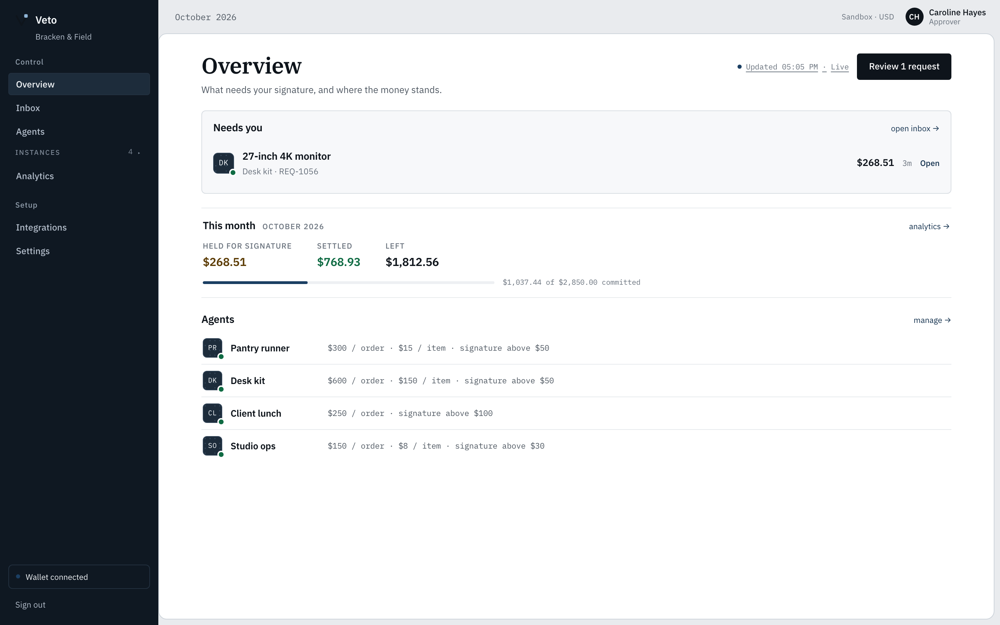
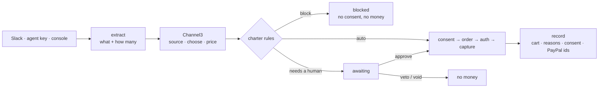
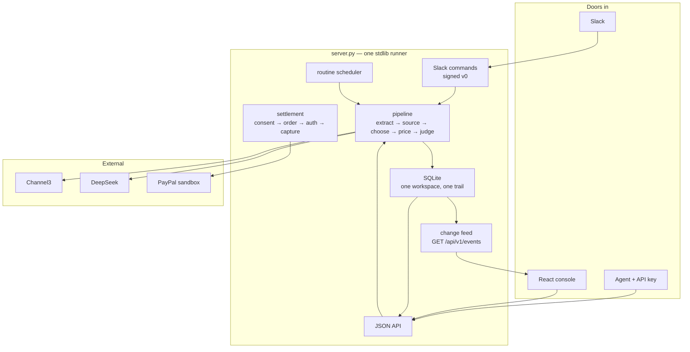

<div align="center">

# Veto

**A consent layer between AI agents and the company PayPal wallet.**
An agent proposes a purchase; the agent's charter judges it; a human signs when it matters;
PayPal moves money only against that signature.

[](https://veto-bracken-field.onrender.com)
[](https://github.com/runake25/veto/actions/workflows/ci.yml)
[](#paypal)
[](#channel3)
[](https://join.slack.com/t/vetollc/shared_invite/zt-4drdephaf-2GOX~63llMwFmLJPM7XFRQ)

### [Open the live demo →](https://veto-bracken-field.onrender.com)

`caroline@brackenfield.demo` · `veto-demo-2026` · or press **Open the demo workspace**

<sub>Built for the PayPal AI Hackathon · sandbox money only</sub>

**Try it in Slack:** [join the Veto llc workspace](https://join.slack.com/t/vetollc/shared_invite/zt-4drdephaf-2GOX~63llMwFmLJPM7XFRQ) · `/veto 2 packs of bamboo toilet paper`



</div>

## The problem

AI agents can already buy things. Checkout assumes a person is at the payment step; an
unattended agent does not have one, so handing it the wallet means money can move without
anyone approving what was bought, from which merchant, at what price or against which budget.
Caps and allowlists help until one cart crosses a line — and at that point the company needs a
signature bound to that exact cart, not a log line after the charge.

## What Veto is

A policy and consent service between the agent and PayPal.

- **One request object.** Slack (`/veto …`), an agent API key and the console's dry run all
  write the same stored request and the same append-only trail.
- **The charter decides.** Monthly budget, per-order and per-item caps, merchant and category
  allowlists, approval threshold — every fired rule is stored with its observed value and limit.
- **Only a signed consent can spend.** A sha256 of the cart, single use, ten minutes by default
  (the hosted demo opens a longer window so a visitor can sign); its nonce is the PayPal
  idempotency key, so a retried approval replays the order instead of charging twice.
- **The catalogue is the rule set.** Channel3 search prices every line; an offer that breaks a
  rule is marked with the rule and the number, not hidden.



## Key tech

| Piece | What it does here |
|---|---|
| **[PayPal Orders v2](https://developer.paypal.com/api/rest/)** | The money rail: `AUTHORIZE` → capture in the sandbox. Every order, authorization and capture id is stored on the request; the consent nonce is the PayPal idempotency key. Captured is the only status counted as spend. |
| **[Channel3](https://trychannel3.com)** | The catalogue: text search and multi-merchant offers per cart line, streamed into the dry run as items resolve. Rules are shown against real offers; the model never invents a price or a payee. |
| **Agent tooling** | DeepSeek extracts *what* and *how many* and routes an unnamed request to the agent whose scope fits. Prices, limits and totals come from code. |
| **Slack** | One Request URL, six signed commands (`/veto`, `/veto-check`, `/veto-status`, `/veto-budget`, `/veto-routines`, `/veto-help`); Approve/Veto buttons write the same store as the console. |
| **Python stdlib + SQLite** | One HTTP runner, one auditable trail, no framework. |
| **React 19 + TypeScript** | The console: server-sent events for the live board, streamed pipeline frames, keyboard-usable tables and forms. |

## Architecture



## The console


One record: every rule that fired with its observed value and limit, the cart, the PayPal
object chain, the consent hash and window, the trail. Approve, veto and void are gated by state.


Agents are instances with their own charter and standing job. The rest of the console —
[Overview](https://veto-bracken-field.onrender.com/app/#/), [Inbox](https://veto-bracken-field.onrender.com/app/#/inbox),
[Analytics](https://veto-bracken-field.onrender.com/app/#/analytics),
[Integrations](https://veto-bracken-field.onrender.com/app/#/integrations),
[Settings](https://veto-bracken-field.onrender.com/app/#/settings) — is in the demo.

## Run it

Python 3.12+ (backend is stdlib only) and Node 22+ for the console.

```bash
cp .env.example .env
cd web && npm ci && npm run build && cd ..
python3 server.py        # http://127.0.0.1:8787
```

No PayPal keys needed: the runner falls back to an in-process PayPal simulator. With
`PAYPAL_LIVE=1` and a vaulted sandbox wallet (`PAYPAL_VAULT_ID`) captures are real sandbox
captures with real ids.

## Verify

```bash
python3 -m unittest discover -s tests   # 343 tests
python3 tools/check_m4.py               # 42 checks: every number a screen reads (read-only)
python3 tools/check_polish.py           # 21 checks: live feed, filters, delete guards, built controls
python3 tools/check_m3.py               # 19 checks: the request loop over HTTP (real pipeline)
python3 tools/check_pipeline.py         # live edge cases: must resolve vs must refuse
cd web && npm run build                 # tsc --noEmit + vite build
```

`check_m3` and `check_pipeline` run the real pipeline and leave genuine history behind;
`seed.py` writes agents and rules, never requests.

## Hosting

The demo runs on Render's free Docker plan from `server.py` + `veto/` + `app/`. A free instance
sleeps after 15 idle minutes and loses its disk, so three independent GitHub Actions warmers ping
it (the `*/5` schedule, a self-renewing bridge, and a second schedule in `runake25/veto-wake`) —
always-on is 744 h in a 31-day month, inside the 750 free hours, so it stays $0.

The disk is ephemeral, so the runner rebuilds the demo on a cold start: if the record is empty
it replays a month of activity through its own public API (`veto/demo_history.py`, the same
pipeline a person or agent uses), spreads those requests' timestamps across the current month
so Analytics has a month to draw, and leaves one cart waiting for a signature. Requests, rules,
consents and PayPal ids are recorded live — only the replay's dates are arranged.

## Limits

Sandbox money only — no real charges. Refunds are out of scope (`void` withdraws an uncaptured
request; a capture cannot be reversed here). One workspace per runner; no multi-currency,
accounting export, Slack distribution or team management. Category rules are the weakest signal;
merchant, unit, cap and threshold rules do the real work.

## Repo map

```
server.py     one HTTP runner: API · Slack · SSE · built app
veto/         store · pipeline · policy · requests · settlement · routines · events ·
              engine · channel3 · paypal_client · auth · seed · slack_commands
web/src/      React console (screens, components, per-screen stylesheets)
app/          built console served at / and /app/
tests/        343 tests        tools/  live check harnesses + demo history
slack/        app manifest + signature verifier     shots/  screenshots used here
Dockerfile · render.yaml · start.sh · .env.example · DESIGN.md · SPEC.md · PRODUCT.md
```

MIT · built sandbox-only for the PayPal AI Hackathon, October 2026 · [live demo](https://veto-bracken-field.onrender.com) · [design notes](DESIGN.md) · [spec](SPEC.md) · [product truth](PRODUCT.md)

