<div align="center">

# Veto

**Consent, not checkout.**
A control layer between AI agents and the company PayPal wallet — every agent buys inside a
signed charter, a human signs when it matters, and money moves only against that consent.

[](https://github.com/runake25/veto/actions/workflows/ci.yml)
[](https://veto-bracken-field.onrender.com)
[](#how-the-money-moves)
[](https://trychannel3.com)
[](#run-it-locally)
[](LICENSE)

### [Open the live demo →](https://veto-bracken-field.onrender.com)

_Approver: `caroline@brackenfield.demo` · Admin: `ops@brackenfield.demo` · Password:
`veto-demo-2026` · or just press **Open the demo workspace**._


</div>

## What it is

PayPal's checkout already asks a human. Veto exists for the case where **no human is at the
payment step**: an AI agent proposes a cart, Veto judges it against that agent's charter
(monthly budget, per-order and per-item caps, merchant and category allowlists, approval
threshold) and asks a person only when the cart crosses a line. A capture happens only
against a **signed, single-use consent** bound to a hash of the exact cart.

Nothing on screen is a fixture: requests are written by the real pipeline, priced from the
Channel3 catalogue, routed by a model, decided by the stored rules, and paid through the
PayPal Orders sandbox. The blocked and refused carts are as real as the captured ones.

- **Three doors in, one record out.** Slack (`/veto …`), an agent API key, or the console's
  dry run — all produce the same stored request and the same append-only trail.
- **The search is the rule set.** When an agent searches the catalogue, an item that breaks
  one of its rules is marked with the rule and the number, not hidden.
- **Consent is the trust artefact.** A sha256 of the cart, single use, ten minutes; its nonce
  is the PayPal idempotency key, so a retried approval replays the order instead of charging
  twice.

## 🚀 2-minute tour for judges

The live demo is already signed in with real sandbox history: captured carts, one waiting for
a signature, one vetoed, one blocked, three standing-job runs. Follow this path:

| # | Do this | What it proves |
|---|---|---|
| 1 | [Open Overview](https://veto-bracken-field.onrender.com/app/#/) | The page leads with **the decision**, not a chart wall: the cart waiting on a person, its amount and age, and one primary action. |
| 2 | Open that record | The verdict names every rule that fired with **observed value vs limit**, then the cart, the consent hash, and PayPal order → authorization → capture. |
| 3 | Press **Approve & capture** | Money moves in the PayPal sandbox; the record fills with the real capture id and a trail entry signed by the approver. |
| 4 | Open [Inbox](https://veto-bracken-field.onrender.com/app/#/inbox) | Five groups in importance order — **Needs you · All · Settled · Refused · Withdrawn**. A lapsed consent stays in Needs you, marked, with **Send it again**. |
| 5 | Open [Agents](https://veto-bracken-field.onrender.com/app/#/agents) → a **dry run** | The pipeline streams live (`extract → source → choose → price → judge`); every resolved item shows its vendor, price and the rule it hit. |
| 6 | Open [Integrations](https://veto-bracken-field.onrender.com/app/#/integrations) | The rail out (PayPal wallet, connected) and the doors in (agent keys, one Slack URL serving six commands). |
| 7 | Open [Analytics](https://veto-bracken-field.onrender.com/app/#/analytics) | Only **captured** counts as spend; held, stopped and refused money sit beside it, by agent, vendor, category and rule. |

> The console is live. Approve or veto from two tabs (or from Slack) and both update without a
> refresh — the board subscribes to `GET /api/v1/events`. The header says **Live** while the
> stream is connected.

## How the money moves

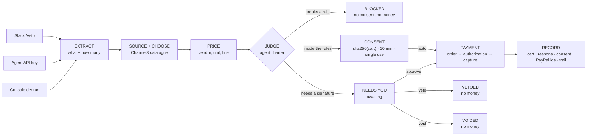

The invariants that make this trustworthy:

- **No capture without consent.** A block, veto or void creates zero PayPal objects.
- **Captured is the only status counted as spend.** Analytics and budgets read the same rule.
- **The model has no authority.** It reads *what* to buy and *who* should judge it; prices,
  payees, limits and totals are decided by code and stored with their reasons.
- **A lapsed consent is still waiting on a person.** It stays in **Needs you**, marked
  `Consent expired`; approve is locked and the record offers *Send it again* with a fresh window.
- **Deletes never erase the trail.** A standing job can be deleted with its runs; an agent
  that has ever made a request is refused (409) and told to pause instead.

## The console

<details>
<summary><b>Overview</b> — what needs a signature, and where the money stands</summary>

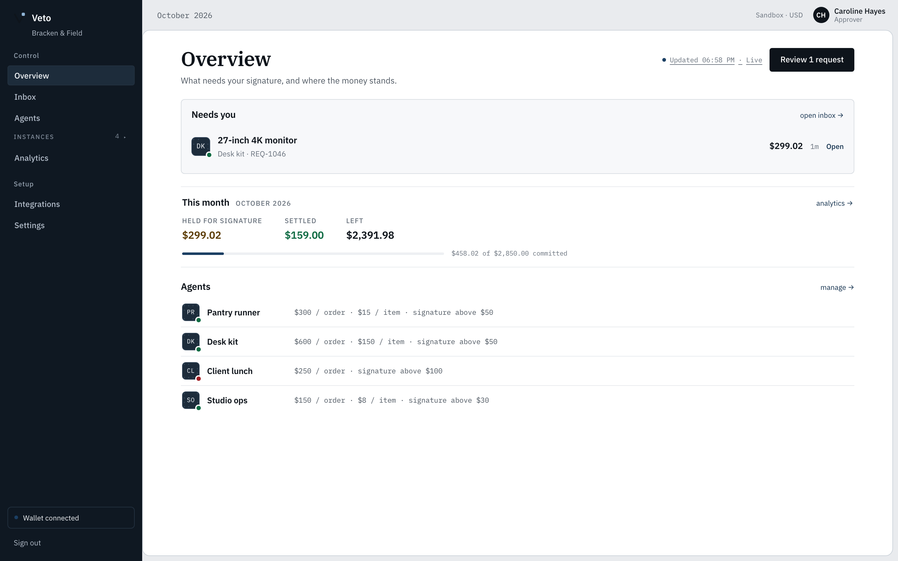

One primary action, the **Needs you** panel with the cart, its agent mark, amount and age, one
quiet *This month* strip (held / settled / left, with the real budget meter), then the agent
fleet. No charts here — Analytics owns those.
</details>

<details>
<summary><b>Inbox</b> — five groups in importance order, lapsed consent stays actionable</summary>

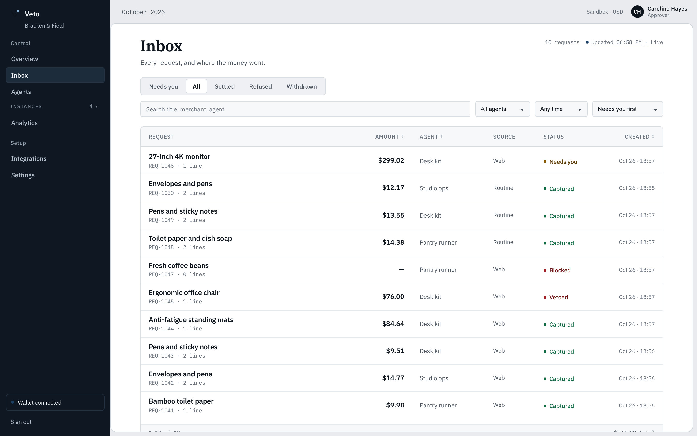

A real table with sortable `aria-sort` headers, search over title/text/agent/requester/merchant,
a day range in the viewer's own calendar, and a footer that reconciles to the filtered total.
The `state=` groups are computed by the server, not the browser.
</details>

<details>
<summary><b>Record</b> — the signed page: verdict, cart, PayPal ids, consent, trail</summary>

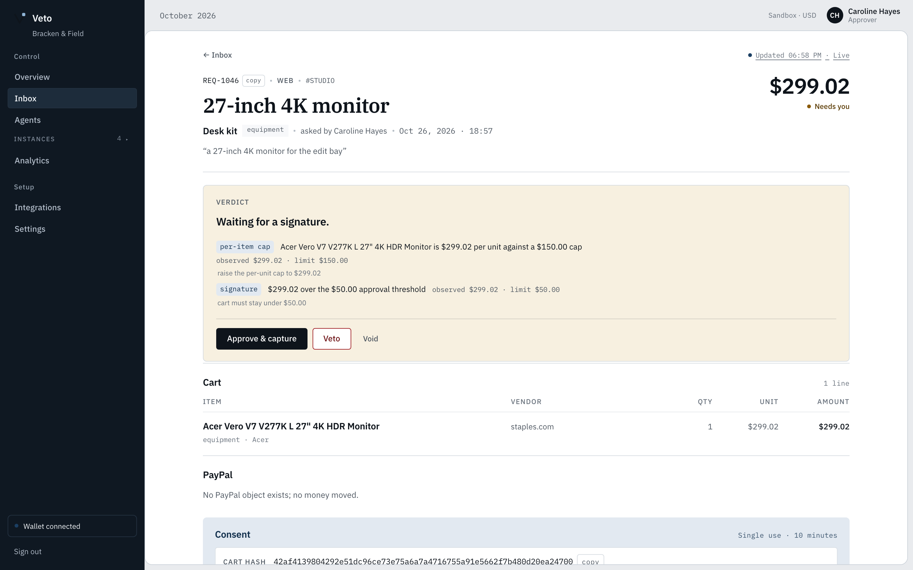

Identity and amount first, then the verdict band with each rule's observed value and limit, then
the cart, the PayPal object chain with copyable ids, the consent hash and window, and the
append-only trail. Every action is gated by state.
</details>

<details>
<summary><b>Agents</b> — a fleet of instances, each with its own charter and standing job</summary>

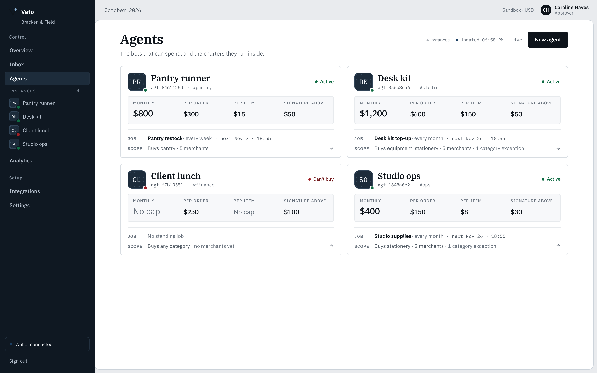

Each agent is a plate — instance mark, serial, channel, state, the four charter figures, its
standing job and the scope it may buy inside. The rail lists the same instances collapsibly.
A single agent page adds the standing job (cadence, envelope, runs, **Run now**), a streaming
dry run, a scoped catalogue search and a danger zone.
</details>

<details>
<summary><b>Analytics</b> — captured vs held vs stopped, by agent, vendor, category, rule</summary>

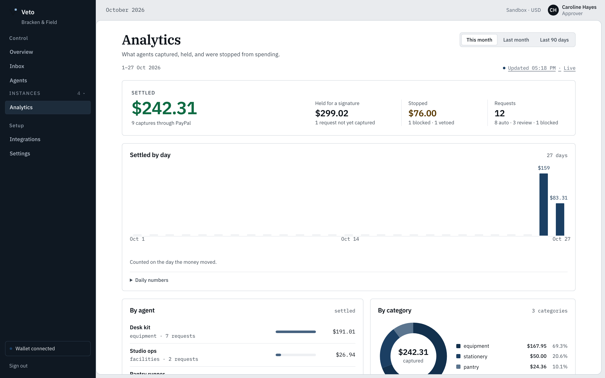

One lead settled figure over quiet held/stopped/requests totals, captured money per day with a
daily table, then agent, vendor, category and what the rules caught — all over one range.
</details>

<details>
<summary><b>Integrations</b> — one wallet out, two doors in</summary>

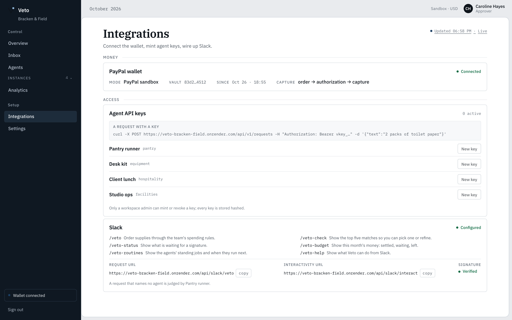

**Money:** the PayPal wallet (mode, vault, payer, capture flow). **Access:** agent API keys
(mint once, stored hashed, revoked immediately) and the single Slack endpoint with its six
commands and signature state.
</details>

<details>
<summary><b>Settings</b> — the seat, the workspace, the rails</summary>

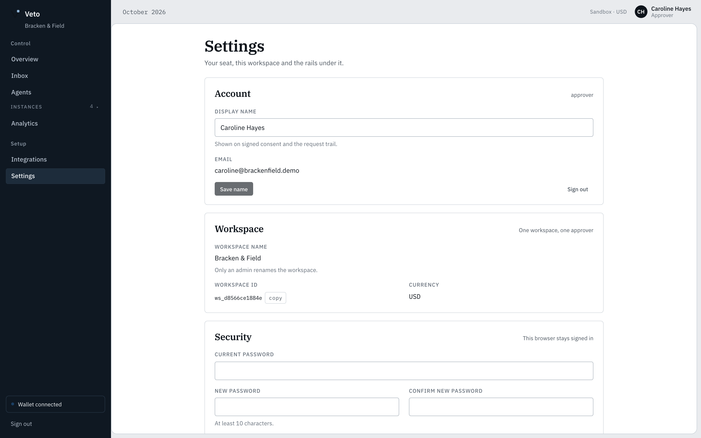

Real writes: display name, workspace name (admin-only), password change with validation, and a
read-only environment block. Backed by `PATCH /api/v1/me`, `PATCH /api/v1/workspace` and
`POST /api/v1/me/password`.
</details>

<p align="center">
  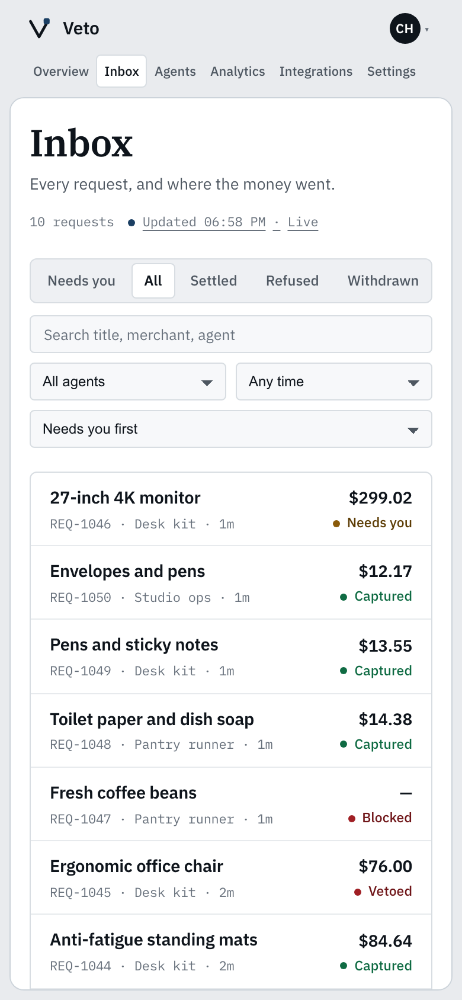
  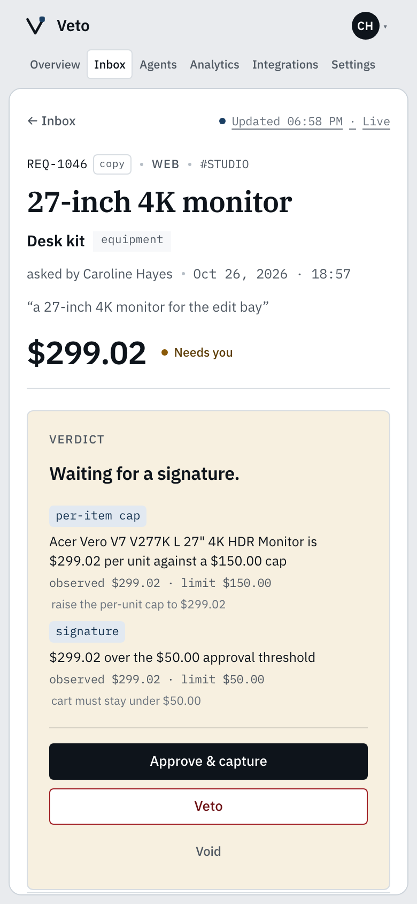
  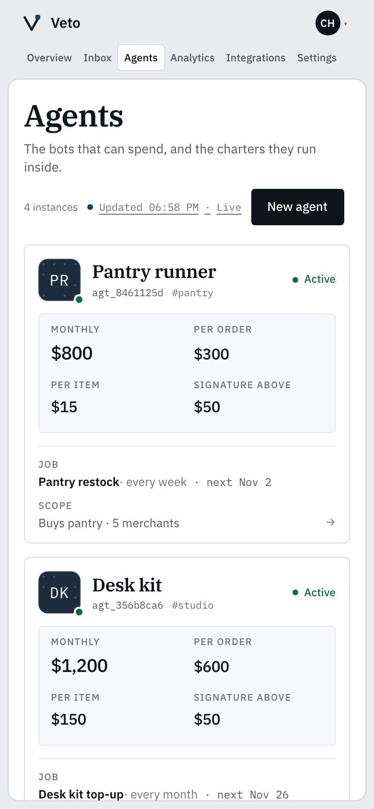
  <br>
  <sub>One console at 390px: the table folds into rows, the record's actions stack, the rail's instances stay reachable.</sub>
</p>

## Slack: one URL, six commands

One Request URL serves every command — Slack sends the invoked command in the payload:

| Command | It does |
|---|---|
| `/veto <what to buy>` | creates the request and model-routes it to the agent whose charter fits |
| `/veto-check <what>` | the top five offers the agent's search returned, each with a **Choose** button |
| `/veto-status [agent]` | what waits for a signature, with **Approve** / **Veto** buttons |
| `/veto-budget [agent]` | this month's settled, waiting and left, per agent |
| `/veto-routines [agent]` | the standing jobs, their next run and last result |
| `/veto-help` | the command list |

Point the Request URL at `https://veto-bracken-field.onrender.com/api/slack/veto` and
Interactivity at `…/api/slack/interact`. Every call is verified against `SLACK_SIGNING_SECRET`
(HMAC v0, replay window); approvals from Slack write the same store as the console, and any open
tab updates through the change feed.

## Agent API in one request

```bash
curl -X POST https://veto-bracken-field.onrender.com/api/v1/requests \
  -H "Authorization: Bearer vkey_…" \
  -H "Content-Type: application/json" \
  -d '{"text":"2 packs of bamboo toilet paper"}'
```

The key scopes the request to that agent's charter (`vkey_` prefix, stored hashed, revoked
immediately from *Integrations*). The response is the full record: priced lines, the decision,
the reasons with observed/limit values, the consent window, and — if it captured — the PayPal
order, authorization and capture ids.

## Architecture

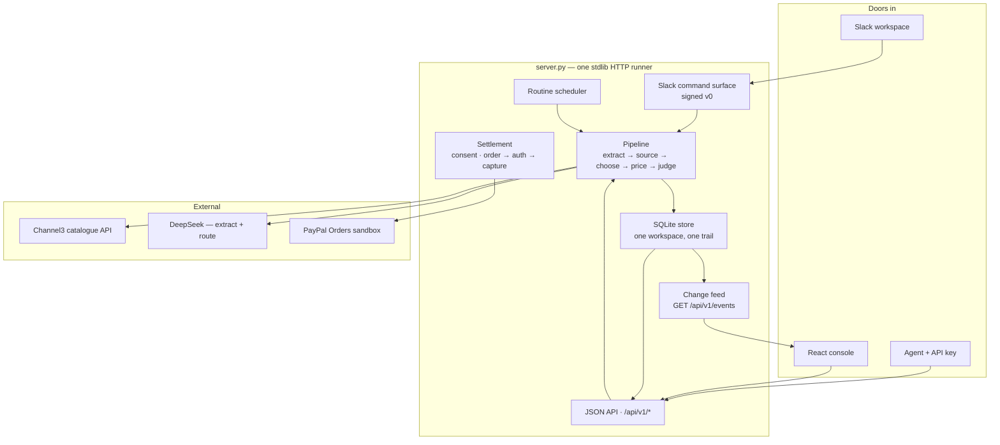

| Layer | Choice | Why |
|---|---|---|
| Runner | Python 3.12+, **stdlib only** | One process, no framework to age out; `ThreadingHTTPServer` + SQLite |
| Store | SQLite with transactional writes | The trail is the product; a single file is auditable and portable |
| Console | React 19 · TypeScript · Vite | Real app surfaces: live table, streamed pipeline, keyboard-usable forms |
| Consent | sha256(cart) · 10 min · single use · nonce = idempotency key | A capture can't outlive the thing a person actually approved |
| Catalogue | Channel3 search + offer choice per item | Real prices, vendors and categories; rules marked, not hidden |
| Money | PayPal Orders v2 sandbox (AUTHORIZE → capture) | The rail this hackathon is about; every object id lands in the record |
| Hosting | Render free Docker + GitHub Actions keep-alive | $0 and always warm for judging (see below) |

## Run it locally

Needs **Python 3.12+** (the backend is stdlib only) and **Node 22+** for the console.

```bash
cp .env.example .env                 # PayPal sandbox, DeepSeek, Channel3, Slack — all optional
cd web && npm ci && npm run build && cd ..
python3 server.py                    # http://127.0.0.1:8787
```

Open <http://127.0.0.1:8787> and press **Open the demo workspace** (or sign in as
`caroline@brackenfield.demo` / `veto-demo-2026`). Without PayPal keys the runner uses an
in-process PayPal simulator; with `PAYPAL_LIVE=1` and a vaulted sandbox wallet
(`PAYPAL_VAULT_ID` or `.state/vault.json`) captures are real sandbox captures with real ids.
`./start.sh` additionally opens a quick tunnel for Slack callbacks and writes its URL into
`.env`; the host changes on every start.

## Verify it

[](https://github.com/runake25/veto/actions/workflows/ci.yml)

```bash
python3 -m unittest discover -s tests        # 343 tests — store, policy, pipeline, Slack, consent, routines, SSE, settings
python3 tools/check_m4.py                    # 42 checks — every number a screen reads, read-only
python3 tools/check_polish.py                # 21 checks — change feed, filters, delete guards, built controls
python3 tools/check_m3.py                    # 19 checks — the request loop over HTTP (real pipeline, ~60s)
python3 tools/check_pipeline.py              # live pipeline edge cases — must resolve vs must refuse
cd web && npm run build                      # tsc --noEmit + vite build
```

`check_m3` and `check_pipeline` run the real pipeline against a running runner and leave genuine
request history behind — Overview, Inbox and Analytics then show real sandbox activity.
`seed.py` writes agents and rules, never requests. `check_m4` and `check_polish` are read-only.

## Hosting: free, warm, honest

The public demo runs on Render's free plan as a Docker web service built from [`Dockerfile`](Dockerfile)
(`server.py` + `veto/` + the built `app/`):

- **Sleep.** A free instance would spin down after 15 idle minutes and lose its ephemeral disk.
  Three independent warmers keep it awake, all $0: a `*/5` schedule in
  [`keepalive.yml`](.github/workflows/keepalive.yml), a self-renewing
  [`keepalive-bridge.yml`](.github/workflows/keepalive-bridge.yml) that pings every four minutes
  for ~5.5 hours and dispatches its own successor, and a second schedule in the tiny public
  `runake25/veto-wake` repository. Public-repo Actions minutes are unlimited, and always-on is
  744 h in a 31-day month — inside Render's 750 free instance hours.
- **Data.** The instance seeds the demo workspace on boot; the history is real sandbox activity
  created through the product. `python3 tools/demo_history.py --base <url>` recreates it through
  the public API — every request runs the live pipeline and captures through PayPal sandbox.
- **Deploy.** `render.yaml` is the blueprint; or `render deploys create <service> --commit <sha>`.
  Secrets are never in the repo — the platform injects the same variables listed in `render.yaml`.

## Built for the PayPal AI Hackathon

| Prize | How this build earns it |
|---|---|
| **Best Use of Agentic Commerce** | A complete agent-commerce loop inside policy: agent proposes, Veto judges, a human signs, PayPal captures, the record explains itself. Three doors in (Slack, agent keys, console), one consent object out, and a live board that follows the money. |
| **Best Use of Channel3** | Every cart line is sourced and priced from the Channel3 catalogue, with multi-merchant offers, per-item choice and a dry run that streams the search as it resolves. Rules are shown against real offers — the catalogue is the rule set, not a mock menu. |
| **Battle-tested product** | 343 tests, three live check harnesses, a CI workflow, screenshots at 1440/390, real PayPal sandbox captures, no fixtures in the store, and an honest limits list below. |

Read more: [`PRODUCT.md`](PRODUCT.md) (what it refuses to claim) · [`DESIGN.md`](DESIGN.md)
(the design system) · [`SPEC.md`](SPEC.md) (behaviour, API, data model).

## Limits — what it refuses to do

Sandbox money only — **no real charges**. Refunds are out of scope: `void` withdraws an
uncaptured request, and captured money cannot be reversed here. One workspace per runner; no
multi-currency, no accounting export, no Slack distribution/OAuth, no team management. Category
rules are the weakest signal — merchant, unit, cap and threshold rules do the real work. On
Render's free plan a sleeping instance loses its ephemeral history; the keep-alive workflow and
boot reseed exist for that, and a redeploy reseeds the workspace (agents and rules only — the
history is recreated through `demo_history.py`, never seeded as fake requests).

## Repository map

```
server.py              one HTTP runner: JSON API, Slack commands, SSE feed, built app, /connect
veto/                  the product
  store.py             SQLite schema + every read/write, workspace-scoped
  pipeline.py          extract → source → choose → price
  policy.py            the charter rules and their reasons
  requests.py          the request board: create, decide, void, settle
  settlement.py        the only money mover (consent → PayPal → capture)
  routines.py          standing jobs: cadence, envelope, dedupe, scheduler
  events.py            in-process change feed behind GET /api/v1/events
  engine.py            extraction + routing model calls, catalogue, mocks
  channel3.py          the catalogue client
  paypal_client.py     PayPal Orders REST client (sandbox)
  mock_paypal.py       in-process PayPal simulator for a key-less run
  auth.py              scrypt passwords, sha256 sessions, hashed API keys
  seed.py              the demo workspace — agents and rules, never requests
  slack_commands.py    the six Slack commands and their buttons
  check.py             top-five offer shortlists for /veto-check
  routing.py           semantic agent routing
  ratelimit.py         per-door minute limits (429 + Retry-After)
web/src/               React 19 + TypeScript console
  screens/             Overview · Inbox · Record · Agents · AgentDetail · Analytics ·
                       Integrations · Settings · Auth
  components/          state.tsx (one status language) · AgentAvatar · freshness (SSE) ·
                       AgentForm · StandingJob · Bits · BootSheet
  styles/              tokens.css + app.css + one stylesheet per screen
app/                   the built console served at / and /app/
tools/                 check_m3 · check_m4 · check_polish · check_pipeline · demo_history · shoot
tests/                 343 stdlib unittest tests
slack/                 app manifest, install link, signature verifier
.github/workflows/     ci.yml · keepalive.yml · keepalive-bridge.yml
shots/                 live screenshots used above
Dockerfile · render.yaml · start.sh · .env.example
```

## License

MIT — see [`LICENSE`](LICENSE).
